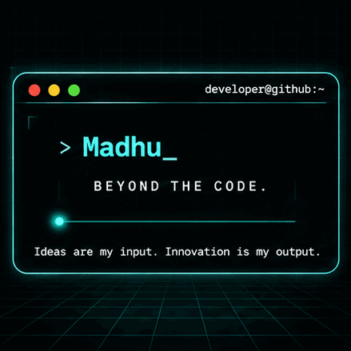

<div align="center">



**Ideas are my input. Innovation is my output.**

`BUILD` · `LEARN` · `IMPROVE`

</div>

---

### `> whoami`

Hey, I'm Madhumitha!

An AI & Data Science undergraduate passionate about programming, software development and data analytics.

I enjoy solving problems, exploring technologies and learning how things work behind the scenes.

### `> technical_skills`

**Programming Languages**

`Python` `Java` `C` `C++` `SQL`

**Tools & Technologies**

`Git` `GitHub` `MySQL` `Django` `Flask` `AWS`

**Data & Analytics**

`NumPy` `Pandas` `Excel` `Tableau`

### `> currently_learning`

- Java and Data Structures & Algorithms
- SQL and data analysis
- Python libraries for Data Science
- Backend development and cloud technologies

### `> my_approach`

```text
01  Curiosity over comfort.
02  Understanding over memorizing.
03  Consistency over perfection.
04  Progress, one commit at a time.
```

### `> find_me`

<div align="center">

<a href="https://github.com/madhumitha2127">GitHub</a>
&nbsp; | &nbsp;
<a href="https://leetcode.com/u/MADHUMITHA__A/">LeetCode</a>

</div>

---

<div align="center">


</div>
